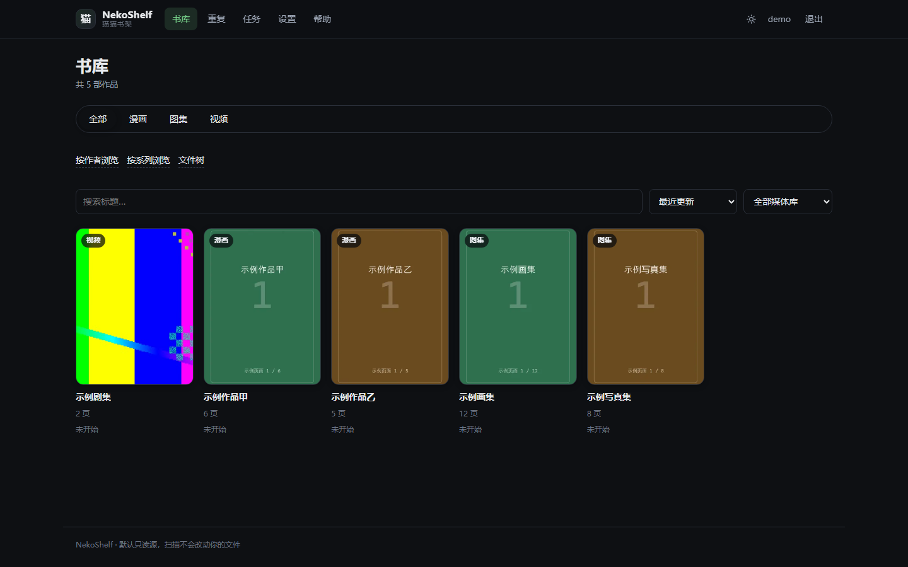
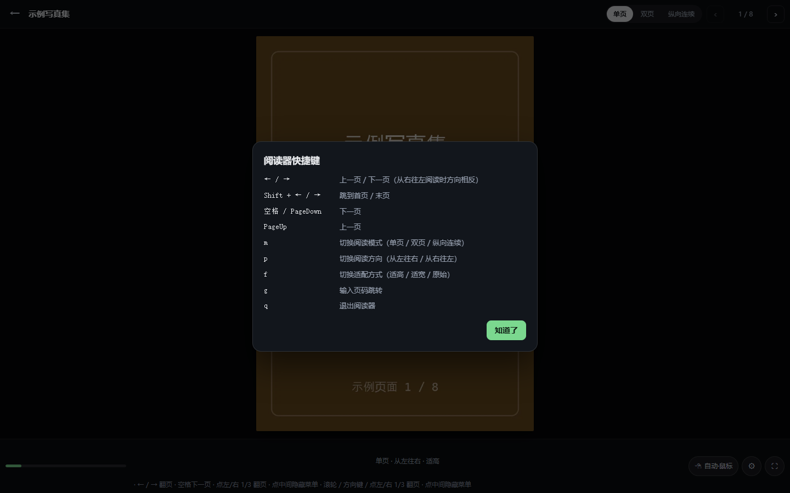
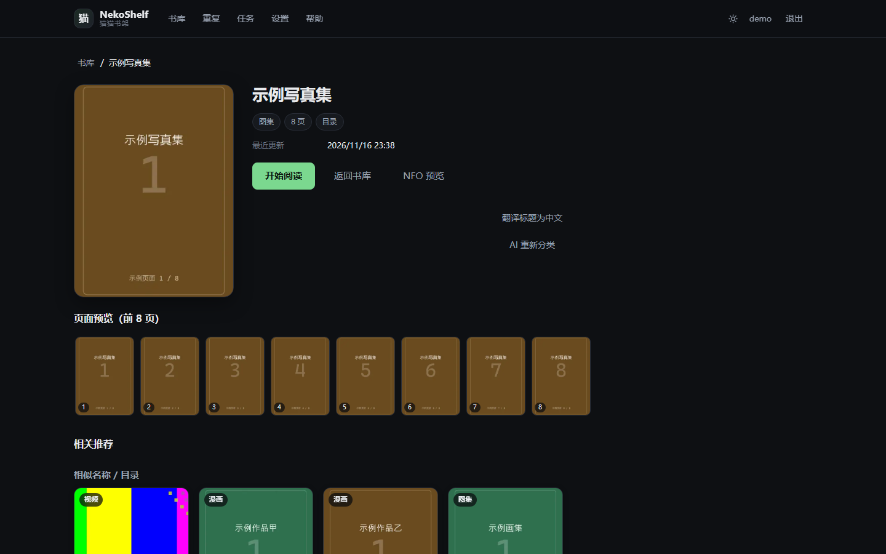
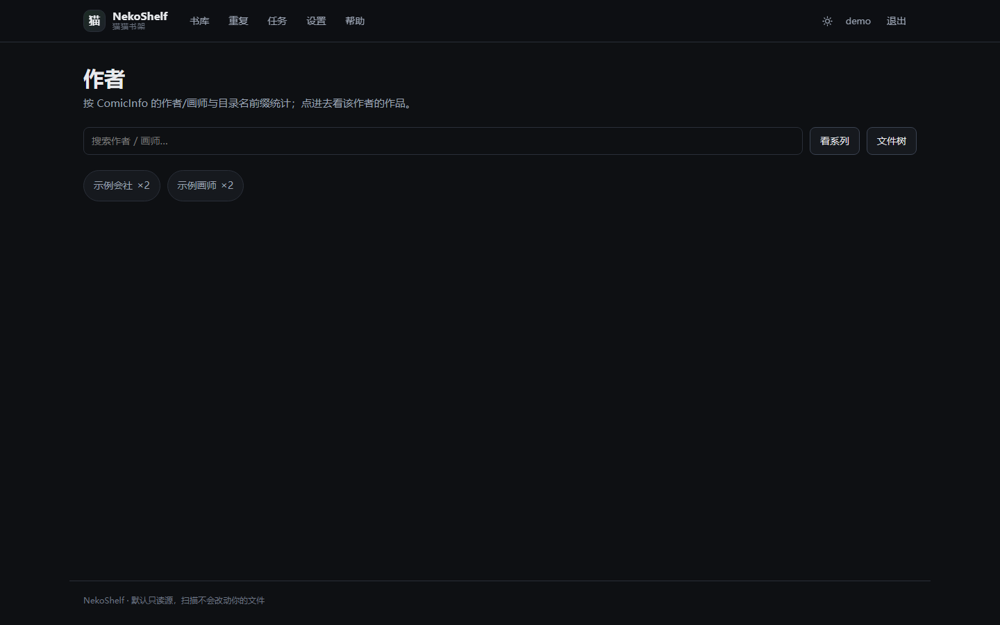
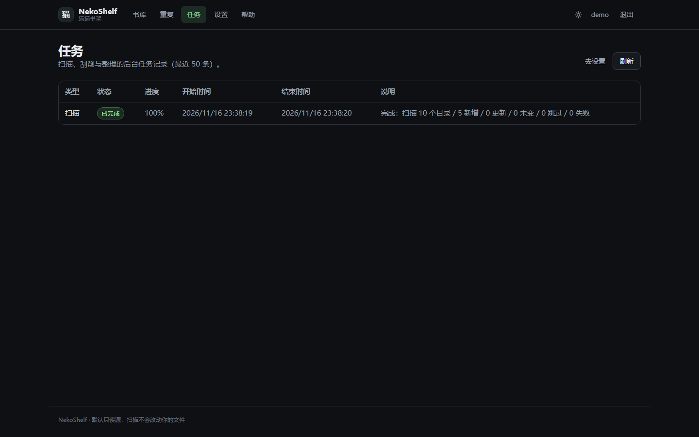
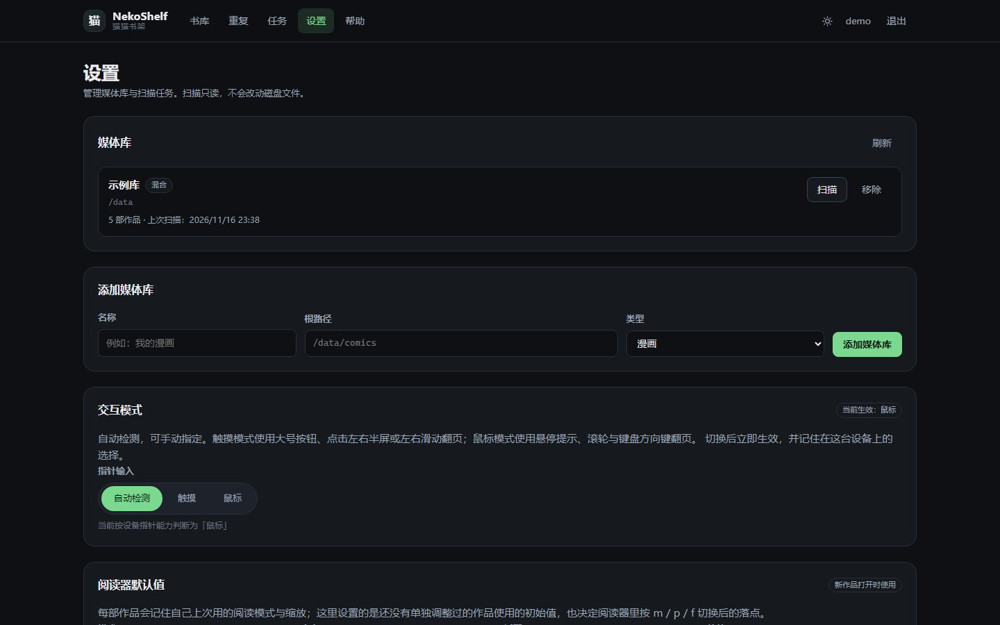

# NekoShelf


[中文](README.md) | **English**

A single-container private media library for the home NAS: it indexes **manga folders, archives (.zip/.7z/.rar/.cbz), image sets and videos** into one browsable library you can read and play in the browser. **Read-only by default** — no renaming, no extracting, no moving your files.

- Zero organization: mount a folder and browse it; on-disk layout is preserved (a raw file-tree browser is included too).
- Rich filenames: parses gid, release codes, declared page counts, groups and version suffixes from folder/archive names.
- Reads archives in place: zip via central directory, rar/7z extracted page-by-page into cache — no full extraction.
- Chinese-first: titles can be translated by an LLM and shown before the original name.
- Mobile ready: phone/tablet layouts, with a manual touch/mouse interaction-mode switch.

## Features

| Feature | Notes |
| --- | --- |
| Scanning | Read-only, incremental; in-progress downloads (`.part`/`.pptd`/`.aria2` …) are skipped |
| Reader | Single page / double page / long strip; direction, fit, zoom, preload; progress saved automatically |
| Archives | zip read in place, 7z/rar pages extracted into cache; video archives extracted on demand |
| Bilingual pages | `_A` / `_A_CN` / `_EN` pairs are matched; switch Chinese / original / side-by-side |
| Search | keywords, `-exclude`, `$exact`, wildcards, tags, page/progress filters; full contract at `GET /api/openapi.json` |
| AI search | A sentence is translated by the model into the local query syntax (DeepSeek by default, off by default) |
| Authors & series | Extracted from ComicInfo and folder names; browse by author/series with related works |
| File tree | Browse the real on-disk structure (read-only); entries that map to works open directly |
| E-H metadata | Optional: fill missing tags/pages from the e-hentai mirror (off by default, manual one-by-one) |
| Organize & write-back | Rename/NFO write-back is preview-only (dry-run) by default; enabling it needs env + toggle + confirm, and every write is journaled/undoable |
| Duplicates | Title normalization + page-count comparison; groups and merge previews, never auto-deletes files |
| Backup | Online consistent snapshot (`VACUUM INTO`); backup/restore/upgrade scripts ship with the deploy bundle |
| Client API | Bearer tokens (read/write/admin scopes), `/api/meta`, OpenAPI, CORS allow-list |

## Quick start

```bash
docker run -d --name nekoshelf -p 8080:8080 \
  -v /your/media:/data:ro \
  -v /your/config:/config \
  -v /your/cache:/cache \
  -e PUID=1000 -e PGID=1000 -e TZ=Asia/Shanghai \
  nekoshelf:0.6.1
```

Open `http://NAS_IP:8080` → you'll be redirected to `/setup` to create the admin account → add a library (root path inside the container, e.g. `/data`) → hit Scan. Scanning is read-only and the library stays browsable while it runs.

Or use Compose:

```bash
docker buildx build -t nekoshelf:0.6.1 --load -f docker/Dockerfile .
docker compose -f docker/docker-compose.yml up -d
```

## UI

Screenshots below use **synthetic sample data** (sample works, authors and pages) — no real media content.

| Library | Reader |
| --- | --- |
|  |  |

| Work detail | Browse by author |
| --- | --- |
|  |  |

| Jobs | Settings |
| --- | --- |
|  |  |


## Environment variables

| Variable | Default | Description |
| --- | --- | --- |
| `PUID` / `PGID` / `UMASK` | `1000/1000/022` | Runtime identity; `/config` is chowned to it |
| `TZ` | `Asia/Shanghai` | Time zone |
| `HTTP_PORT` | `8080` | Container listen port |
| `BASE_PATH` | empty | Sub-path reverse proxy (e.g. `/nekoshelf`); empty = root |
| `DATA_MODE` | `readonly` | `writeback` enables organize/NFO write-back (plus in-app toggle and confirmation) |
| `CONFIG_DIR` / `CACHE_DIR` | `/config` / `/cache` | Config and cache |
| `CACHE_LIMIT_GB` | `20` | Total cache budget (thumbs:extract:transcode = 4:3:3) |
| `MAX_TRANSCODE` / `HWACCEL` | `1` / `auto` | Transcode concurrency and HW acceleration |
| `ENABLE_SCRAPER` | `false` | Hard switch for E-H scraping (no outbound requests when off) |
| `ENABLE_LLM_SEARCH` | `false` | Hard switch for AI search/translation/classification |
| `LLM_BASE_URL` / `LLM_MODEL` / `LLM_API_KEY` | DeepSeek-compatible | LLM endpoint (any OpenAI-compatible gateway) |

See `docs/api-contract.md` for the full list and API contract.

## Security defaults

- Listens on the LAN by default; put it behind HTTPS reverse proxy for remote access.
- `/config` must be a local volume — SQLite WAL breaks on SMB/NFS and the server refuses to start.
- Mount `/data` read-only (`:ro`); read-only scanning is the default behavior.
- Credentials (E-H cookies, LLM keys) are AES-256-GCM encrypted under `/config` with a locally generated master key (0600).
- Write-back operations require three gates and never delete source files.
- Client bearer tokens are scoped and revocable; never put them in URLs.

## Tech stack

Node.js 24 + TypeScript (strict, ESM) · Fastify 5 · built-in `node:sqlite` (WAL) · React 19 + Vite · sharp for WebP thumbnails · ffmpeg/7zz/bsdtar bundled in the image (no user-side tools needed).

```
apps/        server (HTTP API + static web), web (React app)
packages/    core (domain, parsers, scanner, DB), adapters (E-H / LLM)
docker/      Dockerfile, compose
docs/        ADRs, API contract
```

## License

See [LICENSE](LICENSE) and [THIRD-PARTY.md](THIRD-PARTY.md). This project bundles no third-party media content; scraping and AI features are off by default and their use is the operator's responsibility.
