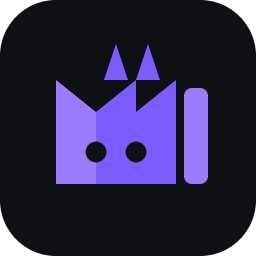
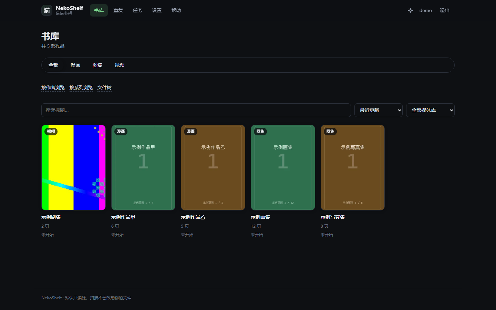
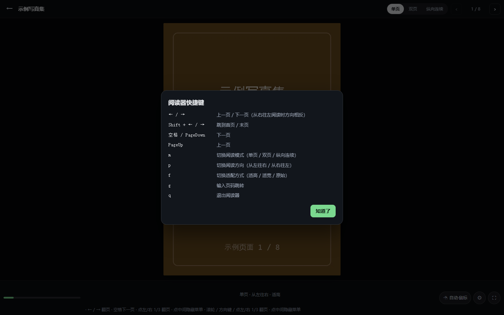
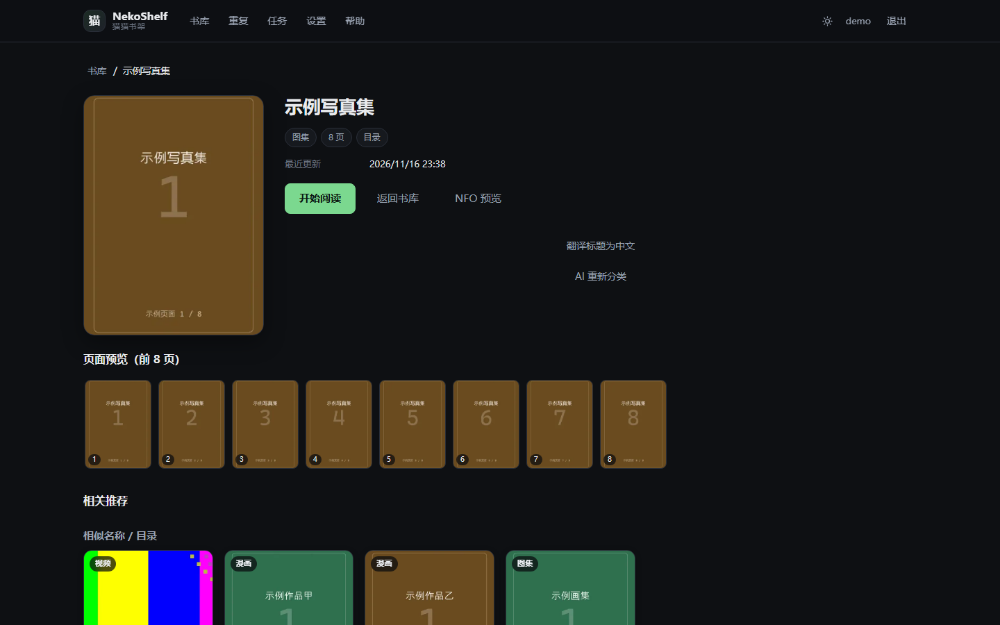
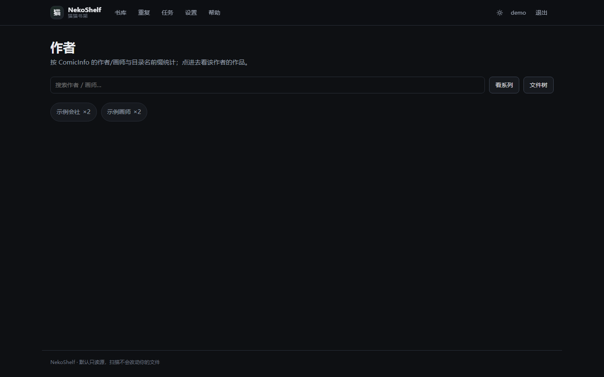
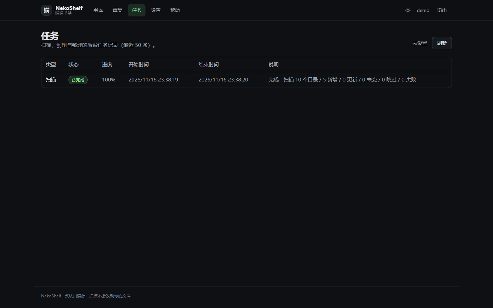
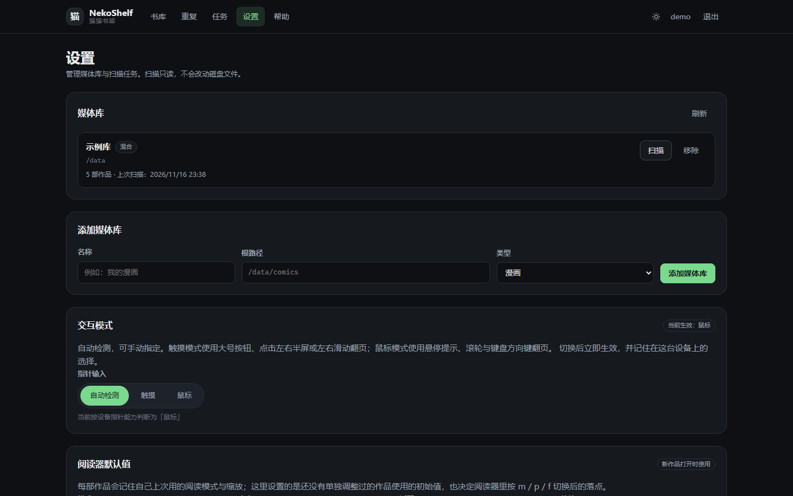

# NekoShelf 猫咪书架



**中文** | [English](README.en.md)

单容器的私有媒体库：把散落在 NAS 上的**漫画目录、压缩包、图片合集和视频**统一索引，浏览器里直接阅读和播放。默认**只读**，不改名、不解压、不搬运你的文件。

- 零整理：挂载即可浏览，目录结构保持原样（也支持按文件树查看）。
- 榨干文件名：从目录名/压缩包名解析 gid、番号、页数声明、汉化组、版本后缀。
- 原地读压缩包：zip 直接读中央目录，rar/7z 单页按需解包缓存，不预解压整包。
- 中文优先：标题可交给大模型翻成中文，列表与详情优先显示中文名。
- 移动端可用：手机/平板自适应，触摸/鼠标交互模式可手动切换。

## 功能

| 能力 | 说明 |
| --- | --- |
| 扫描与索引 | 只读扫描，增量更新；下载中的文件（`.part`/`.pptd`/`.aria2` 等）自动跳过 |
| 书库与阅读器 | 单页 / 双页 / 长条（纵向连续）；方向、适配、缩放、预载；进度自动保存 |
| 压缩包 | zip 直读、7z/rar 单页抽取缓存；不预解压，视频包也按需解包 |
| 双语对照 | 识别 `_A` / `_A_CN` / `_EN` 等语言配对，阅读器可切换中/原/并排 |
| 搜索 | 关键词 + 排除 + 精确 + 通配 + 标签 + 页数/进度过滤；`GET /api/openapi.json` 有完整契约 |
| AI 搜索 | 一句话描述由模型翻译成查询语法后在本地检索（默认 DeepSeek，默认关闭） |
| 作者 / 系列 | 从 ComicInfo 与目录名提取作者，按作者、系列浏览并推荐相关作品；标签按「命名空间：a、b」成行展示，点击即搜索 |
| 合集与章节 | 图集合集 / 视频剧集 / 多话漫画按目录合并为一个作品，详情页列章节、可直接跳到对应分部 |
| 文件树 | 按磁盘真实目录结构浏览（只读），带作品标记的条目可直接打开 |
| E-H 元数据 | 可选：以里站为源补齐标签/页数（默认关闭，只补缺失，手动单条触发） |
| 整理与写回 | 重命名/NFO 写回默认只预览（dry-run），开启写回需环境变量+开关+二次确认，并留可撤销记录 |
| 去重 | 标题归一 + 页数比对，给出疑似重复分组与合并预览（不自动删文件） |
| 备份与发布 | 在线一致性快照（`VACUUM INTO`）；备份/恢复/升级脚本随部署包提供 |
| 客户端 API | Bearer Token（read/write/admin 作用域）、`/api/meta`、OpenAPI、CORS 白名单 |

## 快速开始

```bash
docker run -d --name nekoshelf -p 8080:8080 \
  -v /你的媒体目录:/data:ro \
  -v /你的配置目录:/config \
  -v /你的缓存目录:/cache \
  -e PUID=1000 -e PGID=1000 -e TZ=Asia/Shanghai \
  nekoshelf:0.6.4
```

打开 `http://NAS地址:8080` → 首次会跳到 `/setup` 设置管理员账号 → 添加媒体库（根路径填**容器内**路径，如 `/data`）→ 点扫描。扫描只读，期间可以正常浏览已索引内容；点开作品即可阅读。

也可以用 Compose：

```bash
docker buildx build -t nekoshelf:0.6.4 --load -f docker/Dockerfile .
docker compose -f docker/docker-compose.yml up -d
```

## 界面

以下截图来自**合成示例数据**（示例作品、示例作者、示例页面），不含任何真实媒体内容。

| 书库 | 阅读器 |
| --- | --- |
|  |  |

| 作品详情 | 按作者浏览 |
| --- | --- |
|  |  |

| 任务中心 | 设置 |
| --- | --- |
|  |  |

## 环境变量

| 变量 | 默认 | 说明 |
| --- | --- | --- |
| `PUID` / `PGID` / `UMASK` | `1000/1000/022` | 运行身份与文件权限；`/config` 会按此 chown |
| `TZ` | `Asia/Shanghai` | 时区 |
| `HTTP_PORT` | `8080` | 容器内监听端口 |
| `BASE_PATH` | 空 | 子路径反代（如 `/nekoshelf`）；空为根路径 |
| `DATA_MODE` | `readonly` | `writeback` 才允许整理/NFO 写回（另需开关与二次确认） |
| `CONFIG_DIR` / `CACHE_DIR` | `/config` / `/cache` | 配置与缓存 |
| `CACHE_LIMIT_GB` | `20` | 总缓存上限（缩略图:解压:转码 = 4:3:3） |
| `MAX_TRANSCODE` / `HWACCEL` | `1` / `auto` | 转码并发与硬件加速（`vaapi`/`qsv`/`none`） |
| `ENABLE_SCRAPER` | `false` | E-H 刮削硬开关（默认不发起任何外网请求） |
| `SCRAPER_PROXY` | 空 | 刮削出站代理 |
| `ENABLE_LLM_SEARCH` | `false` | AI 搜索/翻译/分类硬开关 |
| `LLM_BASE_URL` / `LLM_MODEL` / `LLM_API_KEY` | DeepSeek 兼容 | LLM 服务（可换 OpenAI 兼容网关） |

完整清单与接口约定见 `docs/api-contract.md`。

## 安全默认值

- 默认只监听局域网；外网访问请套 HTTPS 反向代理，只放行必要路径。
- `/config` 必须是本地卷：SQLite WAL 在 SMB/NFS 上会损坏并拒绝启动。
- `/data` 建议只读挂载（`:ro`），默认行为就是只读扫描。
- 凭据（E-H Cookie、LLM Key）以 AES-256-GCM 加密存于 `/config`，主密钥本地生成（0600）。
- 写回类操作三重门禁：`DATA_MODE=writeback` + 站内开关 + 每次确认；不删源文件。
- 客户端 Bearer Token 有作用域，泄露后可吊销；不要拼进 URL。

## 技术栈

Node.js 24 + TypeScript（strict、ESM）· Fastify 5 · 内置 `node:sqlite`（WAL）· React 19 + Vite · sharp（WebP 缩略图）· 镜像内置 ffmpeg/7zz/bsdtar（无需用户自备解压工具）。

```
apps/        server（HTTP API + 静态前端）、web（React 前端）
packages/    core（领域模型、解析规则、扫描器、DB）、adapters（E-H / LLM 适配器）
docker/      Dockerfile、compose
docs/        ADR、API 契约、截图
```

## 许可

见 [LICENSE](LICENSE) 与 [THIRD-PARTY.md](THIRD-PARTY.md)。本项目不内置、不打包任何第三方媒体内容；刮削与 AI 功能默认关闭，使用产生的合规责任由使用者承担。
